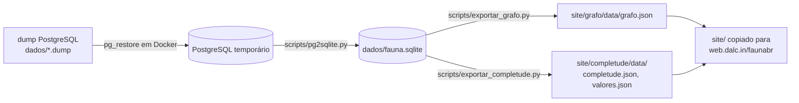

# faunaAnalises

Análises e visualizações do conteúdo do [Catálogo Taxonômico da Fauna do Brasil](https://fauna.jbrj.gov.br/fauna/listaBrasil/PrincipalUC/PrincipalUC.do?lingua=pt) (CTFB, JBRJ), geradas a partir de uma cópia integral da base de dados e publicadas como páginas estáticas em <https://web.dalc.in/faunabr/>.

Projeto irmão de [faunabr](https://github.com/edalcin/faunabr), que guarda a pesquisa de arquitetura, o glossário (`CONTEXT.md`) e o mapa de decisões ([issue #1](https://github.com/edalcin/faunabr/issues/1)) desta primeira análise.

## Análises

| Página | O que mostra |
|---|---|
| `site/grafo/` | Quem cuida de cada grupo da fauna brasileira: taxonomistas, grupos que coordenam e grupos órfãos. Abas: Grupos e responsáveis (lista + grafo de foco), Árvore dos grupos (radial) e Taxonomistas (coordenação direta, abrangência e atividade de cada pessoa). Método em `site/grafo/metodo.html`. |
| `site/completude/` | Completude de cada grupo da fauna brasileira: quanto dos 18 atributos das espécies aceitas está preenchido, por grupo e por domínio, com o Domínio de Valores de cada atributo. Método em `site/completude/metodo.html`. |

## Pipeline



1. **Dump → PostgreSQL** (Docker local, imagem `postgres:18`):
   ```bash
   docker run -d --name faunabr-db -e POSTGRES_PASSWORD=<SENHA> -e POSTGRES_DB=fauna \
     -p 127.0.0.1:5433:5432 -v <PASTA_DO_DUMP>:/d:ro postgres:18
   docker exec faunabr-db pg_restore -U postgres -d fauna -j 4 --no-owner --no-acl /d/<ARQUIVO>.dump
   ```
   A extensão `plv8` não existe na imagem; as 5 funções que dependem dela falham e não afetam os dados.
   O bind mount do Docker no Windows não enxerga compartilhamentos de rede: copie o dump para um disco local antes.
2. **PostgreSQL → SQLite**: `uv run scripts/pg2sqlite.py "postgresql://postgres:<SENHA>@127.0.0.1:5433/fauna" dados/fauna.sqlite`
   (tabelas, PK, UNIQUE, FK, índices e índice FTS5 de nomes; só o schema `public` — `carga`, `historico`, `postgrest` e `ipt_fauna` ficam de fora).
   Depois: `docker rm -f faunabr-db`.
3. **SQLite → JSON**:
   - `python scripts/exportar_grafo.py` (lê `dados/fauna.sqlite`, escreve `site/grafo/data/grafo.json`; ~3 s).
   - `python scripts/exportar_completude.py` (lê `dados/fauna.sqlite` e as listas CHECK de `dados/modeloERctf.md`, escreve `site/completude/data/{completude,valores}.json`; ~10 s).
4. **Publicar**: copiar `site/` para `S:\appsdata\web.dalc.in\faunabr` (servidor nginx estático; já bloqueia `.sqlite`/`.db`).
   ```bash
   cp -r site/. /s/appsdata/web.dalc.in/faunabr/
   ```

`dados/` e os JSON gerados ficam fora do git.

## Site

HTML + ES modules + CSS, sem build. Única biblioteca: Cytoscape.js 3.34.3 vendorizada em `site/comum/vendor/`.
Tema claro/escuro, rodapé e créditos comuns em `site/comum/`. Nova análise = nova pasta `site/<slug>/` + um cartão em `site/index.html`.

Para testar localmente: `python -m http.server 8765 --directory site`.

## Dados pessoais

As páginas mostram nome e instituição dos taxonomistas, como o próprio CTFB. E-mail e login nunca são exportados.

## Licença

Código sob Apache-2.0 ([LICENSE](./LICENSE)). Dados e textos derivados sob [CC BY 4.0](https://creativecommons.org/licenses/by/4.0/deed.pt-br), com crédito ao CTFB/JBRJ.
